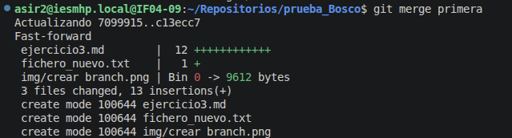
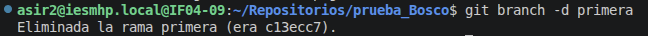
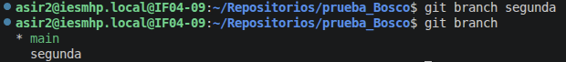
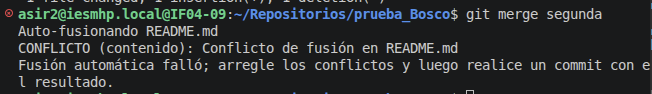

# Ejercicio 2

## Creamos la primera branch

creamos la branch con nombre primera

## Fusionamos las ramas

fusionamos las dos ramas, lo que ocurre es que toda la rama primera se inserta en la rama main

## Borramos la rama primera

borramos la branch

## Creamos la rama segunda

crear la segunda branch

## Generamos un conflicto

generamos un conflicto con un README.md

## Solucion del conflicto

cambiamos el archivo quitando los signos de conflicto